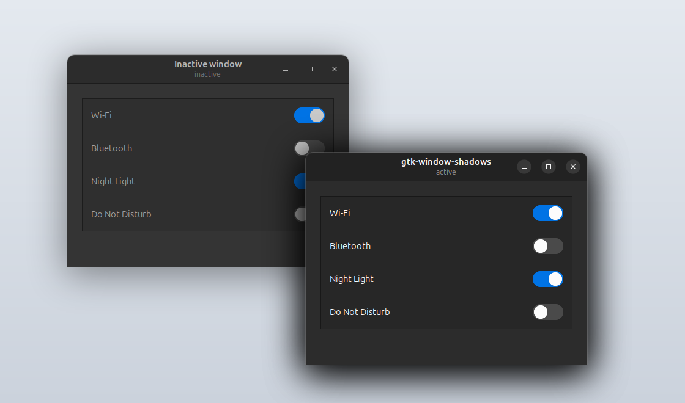
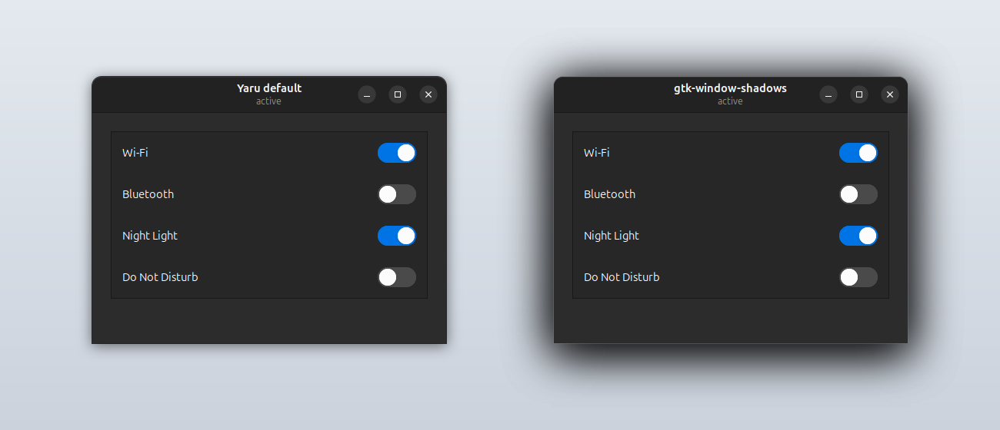

# gtk-window-shadows

Gray 1px window border and macOS-like drop shadows for GTK3 and GTK4 apps on GNOME (libadwaita apps included). One install script, no theme changes.



| | Theme default (Yaru dark) | gtk-window-shadows |
|---|---|---|
| Border | `rgba(0, 0, 0, 0.75)` | `#77777777` |
| Active window shadow | `0 3px 9px 1px`, 50 % black | `0 10px 30px 2px`, two layers (100 % + 60 % black) |
| Inactive window shadow | `0 2px 6px 2px`, 20 % black | `0 10px 30px 2px`, 42 % black (about 30 % of the active shadow) |



Made and tested on Ubuntu 24.04, GNOME 46, Yaru-blue-dark, X11. The rules override the theme from the user CSS, so they also apply with other GTK themes.

## Install

```bash
git clone https://github.com/matsch82/gtk-window-shadows.git
cd gtk-window-shadows
./install.sh
```

The script copies `gtk-window-shadows.css` into `~/.config/gtk-3.0/` and `~/.config/gtk-4.0/` and adds one line, `@import 'gtk-window-shadows.css';`, to the end of each `gtk.css`. It creates `gtk.css` if it's missing and backs it up first (`gtk.css.bak-<date>`) if it exists. Running it again updates `gtk-window-shadows.css` and leaves `gtk.css` alone.

To see the change:
- Restart GTK apps.
- X11: press Alt+F2, type `r`, press Enter. This also reloads the title bars GNOME draws for non-GTK apps.
- Wayland: log out and back in.

## Customize

Edit `~/.config/gtk-3.0/gtk-window-shadows.css` and `~/.config/gtk-4.0/gtk-window-shadows.css`. Keep both in sync.

- **Border color:** `@define-color window_border_color`. GTK3 does not accept 8-digit hex colors like `#77777777`, so use `rgba()` there.
- **Shadow darkness:** `window_shadow_color` and `window_shadow_color2` for the active window. There are two stacked layers because one layer cannot go above 100 % opacity. `window_shadow_color_inactive` sets the inactive window's shadow.
- **Shadow size:** the `0 10px 30px 2px` values (vertical offset, blur, spread). They appear three times per file: twice in the active rule (`decoration` in GTK3, `window.csd` in GTK4) and once in the `:backdrop` rule for inactive windows. Change all three. GTK sizes each window from its shadow, so if active and inactive differ, windows resize and jump whenever focus changes.

GTK CSS has no `!important`. A declaration that uses it is dropped.

Re-running `install.sh` overwrites `gtk-window-shadows.css` with the version from this repository. To keep your edits across devices, edit the files in your clone instead.

## Uninstall

```bash
./install.sh --uninstall
```

This removes the `@import` line and both `gtk-window-shadows.css` files. `gtk.css` is backed up first.

## Limitations

- Apps that draw their own title bar and border aren't affected. Examples: VS Code with its custom title bar, JetBrains IDEs, and Chrome without the system title bar.
- For X11 apps with GNOME-drawn title bars, GNOME Shell draws the shadow itself. Those windows don't get the bigger shadow.
- Over dark backgrounds the shadow is barely visible. A shadow can only darken what is behind it.

## Credits

The window rules are adapted from the [Yaru](https://github.com/ubuntu/yaru) GTK theme (GPL-3.0+); only border and shadow values differ.
